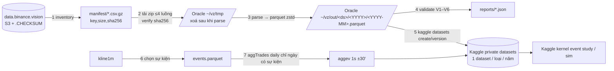

# VZ_DATA_LAKE — kho dữ liệu Binance Vision trên Kaggle (thiết kế + runbook cho OpenClaw)

MASTER 2026-10-13. Mục tiêu: có dữ liệu mà kho nội bộ đang thiếu (taker flow, basis, OI/LS 5m, funding, vi cấu trúc quanh nến sập) để làm **đo theo sự kiện** (event study) với cỡ mẫu lớn. Chỉ nguồn `data.binance.vision`. Không Binance REST (fapi/api) từ Oracle.

## 0. Sự thật đã kiểm (S3 listing 10-13, chỉ đọc)

| Loại (futures/um) | daily | monthly | Bắt đầu (BTCUSDT) | Ghi chú |
|---|---|---|---|---|
| klines (1m) | ✓ | ✓ | 2019-12 | CSV có `taker_buy_volume`, `taker_buy_quote_volume`, `count` — kho nội bộ ĐANG BỎ các cột này |
| premiumIndexKlines | ✓ | ✓ | 2019-12-24 | basis perp vs index |
| markPriceKlines / indexPriceKlines | ✓ | ✓ | 2019-12-23 | |
| metrics (5m: OI, LS, taker ratio) | ✓ | — | 2020-09-01 (BTC); alt ~2021-12 | |
| fundingRate | — | ✓ | | |
| aggTrades | ✓ | ✓ | 2019-12-31 | RẤT LỚN: BTC 2024-08 = 621 MB/tháng zip; DOGE 124 MB; alt nhỏ ~25 MB. ≥ 1 000 symbol ⇒ toàn bộ ~ 2 TB zip ⇒ KHÔNG lưu thô |
| bookDepth | ✓ | — | 2023-01-01 | ~0,46 MB/ngày BTC |
| bookTicker | ✓ | ✓ | 2023-05-16 (đứt 2024-03) | rất lớn, không dùng |
| liquidationSnapshot | ✗ | ✗ | — | KHÔNG có cho UM ⇒ liquidation chỉ có từ thu forward (WS forceOrder) |

## 1. Sơ đồ



## 2. Thiết kế lưu trữ Kaggle (account `chuyendinh`, tất cả PRIVATE)

**Nguyên tắc**
- 1 dataset = 1 loại × 1 năm ⇒ năm đã chốt **bất biến** (không re-upload), chỉ năm hiện hành có version mới hằng tháng. (Kaggle version mới thay toàn bộ file của dataset ⇒ không gộp nhiều năm vào 1 dataset.)
- Tách theo luật quản trị dữ liệu:
  - `…-2020s` = **kho backcast niêm phong** (2020-01-01 → 2021-01-03 UTC) — chỉ dùng theo `docs/plan/BACKCAST_RESERVOIR.md` (1 lần/ý tưởng, qua pre-reg). README ghi SEALED.
  - `…-2021` … `…-2025` = DEV.
  - `…-2026` = holdout ĐÃ DÙNG + forward; không dùng để tune.
- Parquet, nén zstd level 6, row group = 1 symbol (file sort theo `sym, ts`), cột `sym` kiểu dictionary string (KHÔNG dùng id của mapper 242 — id đó đã đổi 10-12).
- Mỗi file tháng ≤ 2 GB; mỗi dataset version ≤ 20 GB (claw kiểm hạn mức thật trước, xem §4 bước 0).

**Danh sách dataset**

| Dataset slug | Nội dung | Schema (cột: kiểu) | Ước lượng |
|---|---|---|---|
| `vz-symbols` | bảng symbol + phủ dữ liệu | sym: str, first_date/last_date theo từng loại: date, n_files: int32, n_gap_days: int32 | < 1 MB |
| `vz-kline1m-YYYY` | kline 1m đầy đủ cột | ts: int64 (open_time ms UTC), sym, open/high/low/close: float64, volume: float64, quote_volume: float64, n_trades: int32, taker_buy_base: float64, taker_buy_quote: float64 | ~3 GB/năm (đo lại ở pilot) |
| `vz-basis1m-YYYY` | premium/mark/index 1m | ts, sym, prem_open/high/low/close: float64, mark_close: float64, index_close: float64 | ~1–2 GB/năm |
| `vz-metrics5m` | metrics 5m mọi năm (nhỏ, 1 dataset; file theo năm) | ts: int64 (create_time ms UTC), sym, oi: float64, oi_value: float64, toptrader_ls_cnt: float64, toptrader_ls_sum: float64, ls_cnt: float64, taker_ls_vol: float64 | ~1–3 GB tổng |
| `vz-funding` | funding mọi năm | ts: int64 (calc_time), sym, interval_h: int16, rate: float64 | < 50 MB |
| `vz-aggev-YYYY` | 1s bar ±30′ quanh sự kiện (Phase 2) | ev_id: int64, sym, ts_s: int64 (giây UTC), n: int32, buy_base/sell_base/buy_quote/sell_quote: float64, vwap: float64, px_first/px_last/px_min/px_max: float64, max_trade_quote: float64 | đo ở pilot |
| `vz-events-YYYY` | danh sách sự kiện đã chọn (Phase 2) | ev_id, sym, ts (phút), ret_1m, taker_sell_share, quote_volume, rule: str | nhỏ |

**Layout trong dataset**
```
vz-kline1m-2024/
  README.md                 # nguồn, khoảng thời gian, schema, governance, md5 từng file
  manifest.csv              # zip nguồn: key, sha256 Vision, size, rows_out
  validate.json             # kết quả V1–V6 của năm
  kline1m/2024-01.parquet … 2024-12.parquet
```

**Sổ đăng ký** (commit vào repo): `docs/data/VZ_REGISTRY.md` — mỗi dataset: slug, version, ngày, khoảng ts, n file, tổng byte, md5 từng parquet, validate PASS/FAIL, commit script.

## 3. Phân kỳ

- **Phase 0 — pilot (bắt buộc trước mọi thứ)**: tháng 2024-08, tất cả loại Phase 1, toàn bộ symbol. Đo: thời gian tải/parse, byte zip vào, byte parquet ra, RAM đỉnh. Ngoại suy tổng. DỪNG báo MASTER nếu ngoại suy > 60 GB Kaggle hoặc > 48 h tải.
- **Phase 1**: kline1m, basis1m, metrics5m, funding — 2020-01 → tháng hoàn chỉnh gần nhất. Thứ tự năm: 2024, 2025, 2023, 2022, 2021, 2026, rồi 2020s (niêm phong, upload riêng).
- **Phase 2**: aggev — chỉ sau khi Phase 1 PASS. Luật chọn sự kiện (chốt trước): phút có `close/open − 1 ≤ −1%` (cùng định nghĩa nến sập của hệ) HOẶC `|ret_1m| ≥ 2%`, symbol có quote_volume phút ≥ 50 000 USDT; gộp sự kiện cùng symbol cách < 30′. Tải aggTrades **daily** chỉ cho (symbol, ngày) có sự kiện; cửa sổ ±30′ (nếu cửa sổ vắt sang ngày khác thì tải cả ngày đó). Pilot Phase 2: 1 tháng, đo số sự kiện + byte; DỪNG báo nếu ngoại suy > 300 GB tải/năm.
- **Phase 3 (chưa làm)**: bookDepth 2023+ → depth 1m (±1/2/5%); thu forward liquidation qua WS forceOrder (sửa `collector/liq_ws.py`) — làm riêng, cần MASTER duyệt.

## 4. Runbook chi tiết (Oracle, user ubuntu, OpenClaw thực thi)

Thư mục: code `~/src/BinanceFuturesJava/research/data/vz/` (branch `data/vz-lake` worktree `~/claude_master/vz_wt`), dữ liệu `~/vz/{manifest,tmp,out,reports,state}`.

**Bước 0 — preflight (chỉ đọc)**
1. `df -h /` ≥ 40 GB trống; `free -g`; không chạy song song job nặng khác (kiểm `ps`).
2. Python: `pyarrow`, `pandas` (hoặc `polars`), `requests`. Thiếu thì `pip install --user`.
3. Kaggle API: tìm cấu hình đang dùng cho kernel sim (grep `KAGGLE_CONFIG_DIR`/`kaggle.json` trong `~/claude_master/1012/ecost/ec_parity.py` và `~/claude_master/1013/ecm/ecm_q.py`); thử `kaggle datasets list --mine`. Ghi hạn mức lưu trữ dataset private hiện hành của tài khoản (trang Kaggle settings/docs) vào report; nếu thấp hơn tổng dự kiến ⇒ DỪNG báo.
4. Network: chỉ được gọi host `data.binance.vision` và `s3-ap-northeast-1.amazonaws.com`. Script phải có allowlist host, gọi host khác ⇒ exception.

**Bước 1 — inventory** (`vz_inventory.py`)
- S3 listing có phân trang: `GET https://s3-ap-northeast-1.amazonaws.com/data.binance.vision?prefix=data/futures/um/<monthly|daily>/<type>/&delimiter=/` lấy danh sách symbol; rồi `?prefix=…/<type>/<SYM>/<interval>/&marker=<last_key>` đến hết (`IsTruncated=false`).
- Loại + interval: klines `1m`, premiumIndexKlines `1m`, markPriceKlines `1m`, indexPriceKlines `1m`, metrics (daily), fundingRate (monthly).
- Ưu tiên file **monthly** cho tháng đã đóng; **daily** chỉ cho tháng hiện hành (và metrics vốn chỉ daily).
- Output `~/vz/manifest/<type>.csv.gz`: key, size, last_modified, checksum_key. Loại symbol: tên kết thúc `USDT` thì giữ; bỏ `*_YYMMDD` (quarterly), `BTCDOMUSDT` giữ riêng cờ (index), stable (`USDCUSDT`, `FDUSDUSDT`, `TUSDUSDT`, `BUSDUSDT`) đánh cờ.

**Bước 2 — tải + verify** (`vz_fetch.py <type> <YYYY-MM>`)
- ≤ 4 luồng, timeout 60 s, retry 5 lần backoff mũ (2,4,8,16,32 s); HTTP 403/404 ghi `missing`, không retry vô hạn.
- Mỗi zip: tải `.CHECKSUM`, so sha256; lệch ⇒ tải lại 1 lần, vẫn lệch ⇒ ghi `bad_checksum`, không parse.
- Ghi tạm `~/vz/tmp/`, parse xong xoá zip. State idempotent `~/vz/state/<type>/<YYYY-MM>.json` (done, n_zip, n_ok, n_missing, n_bad, rows, sha256 parquet). Chạy lại bỏ qua tháng done.

**Bước 3 — parse → parquet** (`vz_build.py <type> <YYYY-MM>`)
- CSV Vision có thể CÓ hoặc KHÔNG có dòng header (đổi theo thời kỳ) ⇒ detect: dòng đầu không parse được số ⇒ header.
- kline cột Vision: `open_time, open, high, low, close, volume, close_time, quote_volume, count, taker_buy_volume, taker_buy_quote_volume, ignore` → map sang schema §2 (bỏ close_time, ignore).
- Mốc thời gian: một số file 2025+ có thể dùng **micro giây** thay mili giây ⇒ nếu ts > 1e14 thì chia 1000. Kiểm và ghi số file bị đổi.
- basis: ghép premium (OHLC) + mark (close) + index (close) theo (sym, ts) outer join; thiếu ⇒ NaN.
- metrics: `create_time` dạng chuỗi datetime ⇒ chuyển ms UTC.
- Sort (sym, ts); bỏ trùng (sym, ts) giữ bản cuối, đếm số trùng.
- Ghi `~/vz/out/<ds>/<YYYY>/<YYYY-MM>.parquet` (zstd 6, row group theo sym), sha256 file.

**Bước 4 — validate** (`vz_validate.py <ds> <YYYY>`) — mọi mục phải PASS mới upload
- V1: 100% zip có checksum khớp, hoặc lý do missing ghi rõ (symbol chưa niêm yết/đã gỡ).
- V2: kline: số phút mỗi (sym, ngày) ∈ [1, 1440]; tổng phút thiếu trong khoảng niêm yết ≤ 0,1% — báo top symbol thiếu.
- V3: kline: `low ≤ min(open,close) ≤ max(open,close) ≤ high`; `0 ≤ taker_buy_quote ≤ quote_volume` (dung sai 1e-9 tương đối); `n_trades ≥ 0`.
- V4: đối chiếu dữ liệu nội bộ (chỉ đọc): `/home/ubuntu/java/fsrun/CLOSES_1H.bin` (14 B BE: ts i8 close-time, sym i2, close f4; map `/home/ubuntu/selector_pred_out/symbol_map.csv`) — close giờ = close phút cuối của giờ: chọn ngẫu nhiên 2 000 (sym, giờ) mỗi năm 2022–2025, |Δ|/close ≤ 1e-6 (float32) ở ≥ 99,9%. (Memory: DEV 2025 khớp Vision 100%.)
- V5: basis: |mark_close/kline_close − 1| p99 < 1% mỗi tháng; |prem_close| p99 < 2%.
- V6: tái lập: build lại 1 tháng ngẫu nhiên lần 2 từ zip ⇒ sha256 parquet trùng.
- Output `~/vz/reports/<ds>-<YYYY>.validate.json`.

**Bước 5 — upload Kaggle** (`vz_upload.sh <ds> <YYYY>`)
- Thư mục upload = `~/vz/out/<ds>/<YYYY>/` + README.md + manifest.csv + validate.json; `dataset-metadata.json`: `{"title": "vz-<ds>-<YYYY>", "id": "chuyendinh/vz-<ds>-<YYYY>", "licenses":[{"name":"other"}]}`; private.
- Lần đầu: `kaggle datasets create -p <dir> -r skip` (KHÔNG `--public`). Năm hiện hành: `kaggle datasets version -p <dir> -m "<YYYY-MM> + validate" -r skip`.
- Sau upload: `kaggle datasets files chuyendinh/vz-<ds>-<YYYY>` ⇒ so tên + size với local; tải ngược 1 file ngẫu nhiên, sha256 phải trùng.
- Cập nhật `docs/data/VZ_REGISTRY.md` + commit (trailer bên dưới). Xoá `~/vz/out/<ds>/<YYYY>` CHỈ SAU khi tải ngược khớp và MASTER/owner đồng ý dọn (mặc định giữ nếu đĩa còn > 40 GB).

**Bước 6–7 — Phase 2 aggev** (`vz_events.py`, `vz_aggev.py`) — chỉ chạy khi MASTER duyệt pilot Phase 2
- events từ `vz-kline1m-YYYY` theo luật §3; aggTrades daily cột `agg_trade_id, price, quantity, first_trade_id, last_trade_id, transact_time, is_buyer_maker` (header có thể có/không). `is_buyer_maker=true` ⇒ taker SELL.
- 1s bar trong [ts−30′, ts+31′): n, buy/sell base & quote, vwap, px_first/last/min/max, max_trade_quote. Xoá zip ngay sau khi xử lý.
- Validate: Σ quote 1s trong mỗi phút vs `quote_volume` kline cùng phút: lệch ≤ 0,5% ở ≥ 99% phút (biên ms có thể lệch — EXEC V1 từng 91,8%; ghi lại, không tự sửa).

## 5. Luật cho người thực thi (OpenClaw)
- KHÔNG gọi Binance REST (`fapi.binance.com`, `api.binance.com`) — Oracle từng bị 418. Chỉ Vision.
- KHÔNG đụng máy 242, shadow (`~/shadow_c3*`, systemd), `~/claudedata`, `~/java`, dataset Kaggle hiện có (đặc biệt `bcast-2020-2021h1-p1`, `sim-*`, `ho4p1-*`).
- Kaggle: chỉ tạo/version dataset `chuyendinh/vz-*`, private. Không đẩy kernel trong job này (tránh chiếm 2 slot kernel).
- Đĩa: giữ ≥ 30 GB trống mọi lúc (kiểm trước mỗi tháng); thiếu ⇒ dừng, báo.
- Job dài: `setsid nohup … > ~/vz/logs/<step>.log 2>&1 &`; state idempotent; báo tiến độ theo năm.
- Code Python dùng `logging`, không `print`. Commit trên branch `data/vz-lake`, không merge, trailer:
  `Co-Authored-By: Claude Opus 5.5 <noreply@anthropic.com>` (nếu OpenClaw tự commit thì ghi tác giả OpenClaw, giữ dòng này cho phần thiết kế).
- Mỗi Phase kết thúc: báo cáo gồm số file/byte/rows/thời gian, validate V1–V6 từng năm, slug + version Kaggle, md5, mọi chỗ lệch thiết kế.

## 6. Lệnh giao OpenClaw (owner dán)

> Đọc `~/src/BinanceFuturesJava/docs/plan/VZ_DATA_LAKE.md`. Làm **Bước 0 + Phase 0 (pilot 2024-08)** đúng runbook §4, tuân §5. Báo cáo: kết quả preflight (hạn mức Kaggle, đĩa, thư viện), số liệu pilot (byte zip vào, byte parquet ra theo loại, thời gian, RAM), ngoại suy cho 2020-01→2026-09, validate V1–V6 của tháng pilot. Upload pilot thành dataset private `chuyendinh/vz-pilot-202408`. DỪNG sau pilot, chờ MASTER duyệt trước Phase 1.
